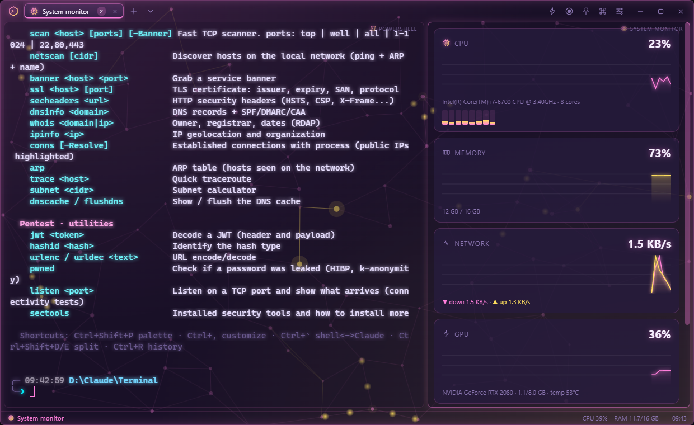
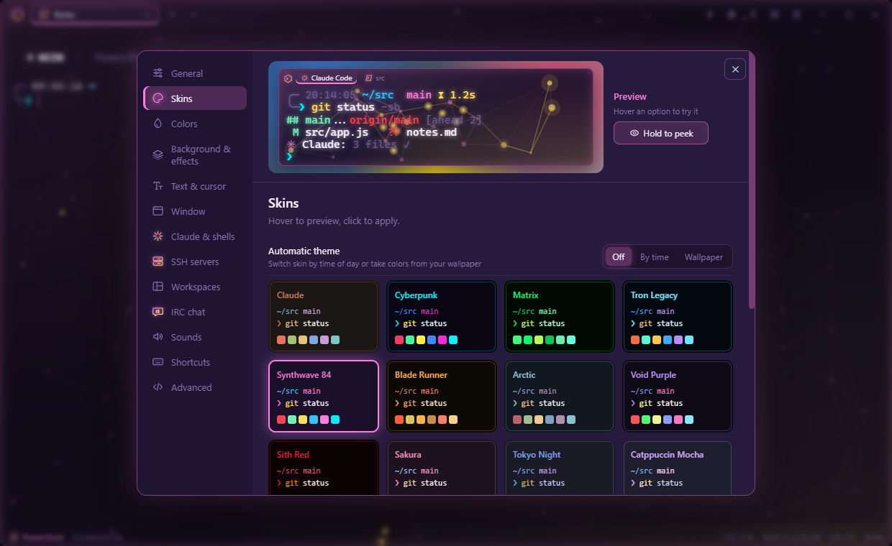
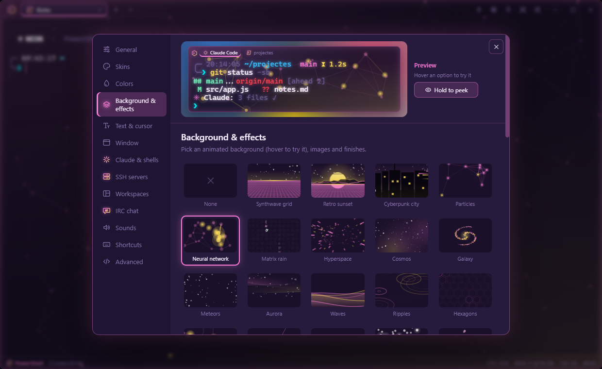
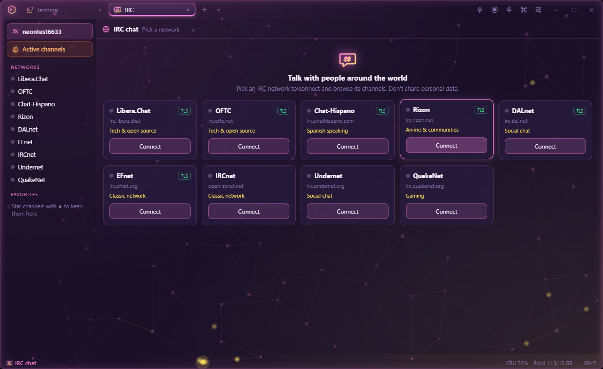
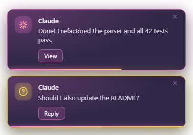

<p align="center">
  
</p>

<h1 align="center">Neon Terminal</h1>

<p align="center">
  A futuristic, fully customizable Windows terminal with <b>Claude Code</b> built in.<br>
  A small floating window that starts with Windows: Claude on top, your own shell below.
</p>



## Highlights

- **Claude Code + your shell side by side.** Claude works in one pane and you run commands in another. Press `` Ctrl+` `` to jump between them.
- **App-style notifications.** When Claude finishes, asks a question or needs permission, a floating card appears in your skin's style. Click it to jump to that pane.
- **Customization:**
  - 24 skins and 30+ animated backgrounds;
  - a live color editor and system font gallery;
  - window materials (acrylic / mica / transparent).
  - A live preview shows every change before you apply it.
- **Tabs and splits.** Nested splits, a session restored on startup, saved workspaces.
- **Lots of extra commands.** More than 100 PowerShell commands for the system, network, files and dev work, plus a set of security / pentest tools.
- **Three languages.** English, Spanish and Catalan, covering both the UI and the shell commands.
- **Built-in extras:**
  - IRC chat;
  - system monitor;
  - window recording (MP4 / GIF);
  - file preview;
  - command history;
  - quick commands;
  - "Ask Claude" when a command fails.

| | |
|---|---|
|  |  |
|  |  |

## Installation

### Installer

Download **[NeonTerminal-Setup-1.1.1.exe](https://github.com/KiritoKurai/Neon_terminal/releases/latest)** from the latest release and run it. It installs the app for the current user and creates the following:

- Start Menu and Desktop shortcuts;
- an uninstaller;
- any missing required dependencies, installed with **winget**: [Claude Code](https://claude.com/claude-code) and ffmpeg.

You can install the optional tools (Git, PowerShell 7, Node.js, Nmap) later from **Settings → Advanced → Dependencies**.

> The installer is not code-signed. The first time you run it, Windows SmartScreen shows a warning: click **More info → Run anyway**.

### Building

Requirements: Windows 10/11 and Node.js 20+.

```powershell
git clone https://github.com/KiritoKurai/Neon_terminal.git
cd Neon_terminal
npm install
npm start          # run from source
npm run dist       # build dist\NeonTerminal-Setup-<version>.exe
npm run pack       # unpacked build only (dist\win-unpacked)
```

> If you launch it from a VS Code terminal, run `Remove-Item Env:ELECTRON_RUN_AS_NODE` first.

## Usage

- The app starts with Windows (you can turn this off in Settings → Window).
- **Ctrl+Alt+Space** shows or hides the window from anywhere (Quake style).
- Shells:
  - Claude Code, PowerShell, PowerShell 7, CMD, Git Bash, WSL, Python, Node;
  - saved SSH servers;
  - the built-in monitor and IRC panes.
- Clipboard: **Ctrl+C** copies the selection, **Ctrl+V** or a **right click** pastes, and **Shift+Enter** inserts a new line in Claude.
- Install commands in the output (`winget install …`, `pip install …`) are clickable and run in a shell.

### Claude notifications

Claude sessions opened in Neon load their own hooks through `--settings`, so your global Claude Code settings are never modified. The hooks report:

- when Claude finishes (Stop);
- when it needs attention (Notification);
- when it asks you a question (AskUserQuestion).

The app shows its own notification card. The tab and the taskbar icon also blink. You can set the behaviour in **Settings → Claude & shells**.

### Shortcuts

| Keys | Action |
|---|---|
| Ctrl+Shift+P | Command palette (themes, effects, snippets, shells…) |
| Ctrl+, | Settings |
| Ctrl+` | Jump between Claude and the shell |
| Ctrl+Shift+A | New Claude session |
| Ctrl+Shift+T / W | New tab / close pane |
| Ctrl+Shift+D / E | Split right / down |
| Ctrl+Shift+F | Search |
| Ctrl+R | Command history (outside Claude) |
| Ctrl+Shift+B | Quick commands |
| Ctrl+Shift+X | Ask Claude about the last error |
| Ctrl+Shift+U | System monitor |
| Ctrl+Shift+L | IRC chat |
| Ctrl+Shift+M | Focus mode |
| Ctrl+Alt+R | Record the window |
| Ctrl+= / − / 0 | Text zoom |
| Ctrl+Shift+Space | Always on top |

You can reassign any shortcut in **Settings → Shortcuts**.

## Features

| Feature | Where |
|---|---|
| **IRC chat**: Libera, OFTC, Chat-Hispano, Rizon, DALnet, EFnet, IRCnet, Undernet, QuakeNet. Includes an active-channels view across networks, a channel browser, ★ favorites, mention notifications, and `/join` `/me` `/msg` `/nick` `/list` `/whois` | Ctrl+Shift+L or the ▾ menu |
| **System monitor**: CPU per core, RAM, network, GPU, disk and top processes | Ctrl+Shift+U |
| **Window recording**: MP4, GIF or WebM (MP4 and GIF need ffmpeg) | ⏺ button or Ctrl+Alt+R |
| **Command history** with search | Ctrl+R |
| **Quick commands** | ⚡ dropdown or a pinned bar |
| **"Ask Claude"** when a command fails | shows up automatically |
| **Workspaces** and restoring the last session | palette → "Save workspace…" |
| **Saved SSH servers** | Settings → SSH servers |
| **Automatic theme**: by time of day or from your wallpaper colors | Settings → Skins |
| **Sounds**: typing sounds and a "command finished" chime | Settings → Sounds |
| **Focus mode**: hides every bar | Ctrl+Shift+M or `focus` |
| **File preview**: images, video, audio, PDF, Markdown, JSON, CSV, folders | `pv <file>` |
| **Long command finished** alert (over 30 s) | automatic |

## Customization (Ctrl+,)

| Section | What you can change |
|---|---|
| Skins | 24 themes, including Claude, Cyberpunk, Synthwave 84, Matrix, Tokyo Night, Catppuccin, Gruvbox, Rosé Pine, Sakura and Vaporwave. You can import and export them |
| Colors | Live editor for every UI color and the ANSI palette |
| Background & effects | Animated backgrounds with live thumbnails (neural network, synthwave grid, retro sunset, cyberpunk city, galaxy, aurora, Matrix rain…), speed and intensity, background image or GIF, blur, opacity, CRT scanlines, gradient |
| Text & cursor | Installed font gallery, size, line height, neon glow, cursor, renderer |
| Window | Material (acrylic / mica / transparent), corners, margins, always on top, global shortcut |
| Claude & shells | Claude arguments (`--continue`, `--model`…), working folder, snippets, startup commands, notifications |

Hover over a skin, background or font to preview it before applying it. While you hold **Hold to peek**, the panel hides so you can see the real terminal.

Settings are stored in `%APPDATA%\Neon Terminal\settings.json`.

## Shell commands

Type `neon` in PowerShell to list them all, or `neon <filter>` to filter them.

- **Appearance**:
  - `theme matrix`, `fx particles`, `opacity 0.7`, `glow off`, `crt on`;
  - `accent #ff00aa`, `wallpaper pic.jpg`, `split`, `pin`, `lang en`.
- **Claude**:
  - `ask <question>`, `explain <command>`;
  - `fixlast` (analyzes the last error);
  - `cc`.
- **System**: `sysinfo`, `top`, `disks`, `uptime`, `battery`, `killp`, `admin`.
- **Network**: `myip`, `ports`, `killport 3000`, `weather London`, `pingg`, `serve`.
- **Files**: `ll`, `mkcd`, `ff`, `grep`, `size`, `bigfiles`, `mark` / `go`, `pv`.
- **Dev**: `gs`, `gl`, `json`, `uuid`, `pass`, `calc`, `cheat tar`, `qr`, `timer`.
- **Fun**: `matrix`, `hack`, `rainbow`, `fortune`, `colors`.
- `notify <text>` shows the app's own notification.

Add your own functions to `~\.neonrc.ps1` (PowerShell) or `~\.neonrc.cmd` (CMD).

### Security & pentest tools

> **Only scan systems you own or are explicitly authorized to test.**

- **Network / recon**:
  - `netinfo`, `wifi`;
  - `scan <host> [top|well|all|1-1024|22,80] [-Banner]`;
  - `netscan [cidr]`, `banner`, `ssl <host>`, `secheaders <url>`;
  - `dnsinfo`, `whois`, `ipinfo`, `conns [-Resolve]`, `arp`, `trace`, `subnet`, `dnscache`, `flushdns`.
- **System audit**:
  - `secaudit` (score from 0 to 100);
  - `defender`, `avscan`, `threats`, `avupdate`;
  - `autoruns`, `procsus`, `svcaudit`, `users`, `logons`, `usbhist`, `shares`, `fwrules`, `hosts`.
- **Malware analysis**:
  - `hashes`, `vt <file>` (looks up the hash on VirusTotal; the file is never uploaded);
  - `sigcheck`, `entropy`, `strings`, `iocs`, `pe`.
- **Utilities**:
  - `jwt`, `hashid`, `urlenc` / `urldec`;
  - `pwned` (HIBP with k-anonymity);
  - `listen <port>`, `sectools`.

### Server audit

Audit your company's servers from the terminal: Linux over SSH (no agent needed), Windows over WinRM (PowerShell remoting).

- **Inventory** (`~\.neon-servers.json`):
  - `srvadd web01 admin@10.0.0.10` (Linux) · `srvadd dc01 10.0.0.5 -Os windows -User CORP\admin`;
  - `servers`, `srvrm`, `srvimport` (imports the app's saved SSH servers), `srvssh <server>`. Server names complete with Tab.
- **Audit**:
  - `srvaudit <server>`: pending and security updates, pending reboot, automatic updates, firewall, SSH settings (root login, passwords), UID-0 / passwordless accounts, sudo `NOPASSWD`, fail2ban, SELinux/AppArmor, NTP, disk, failed logins and exposed ports. On Windows: Windows Update, Defender, SMBv1 / SMB signing, RDP NLA, NTLMv1, LSA, WDigest, legacy TLS, password policy, Print Spooler. Each check is scored from 0 to 100. Checks that need root use `sudo -n`, so they're skipped without passwordless sudo.
  - `netaudit <server> [-Deep]`: an outside view of the server. It checks open ports, expired or untrusted certificates, TLS 1.0/1.1, HTTP→HTTPS and security headers, plus Telnet, anonymous FTP and Redis/Elasticsearch/Memcached/Docker reachable without authentication. `-Deep` adds `nmap --script vuln`.
  - `srvlynis <server>` runs [Lynis](https://cisofy.com/lynis/) on a Linux server.
  - `auditall [-Net]` audits every server and saves one report per server to `~\NeonAudits\<date>\`. `report <command>` saves the output of any command.

### Updates

- `updates` lists this PC's software that has updates available (winget) plus pending Windows updates. Each line is clickable to update it.
- `upgrade <id>`, `upgrade all` (winget) or `upgrade win [-Security]` (Windows Update, as admin).
- `srvupdates <server>` lists a server's pending packages, with security updates marked.
- `srvupgrade <server> [-Security]` asks for confirmation, then updates the server.
  - Linux: apt / dnf / yum / zypper / apk / pacman. sudo asks for your password in the terminal.
  - Windows: runs Windows Update as SYSTEM through a temporary scheduled task and shows the log live.
  - In both cases it reports when a reboot is needed, but never reboots by itself.

## Project structure

```
main.js            Electron main process: windows, PTYs, settings, Claude hooks, notifications
main-features.js   history, monitor, wallpaper, file preview and recording services
irc.js             minimal IRC client (main process)
preload.js         API exposed to the UI (window.neon)
src/               UI: renderer, settings panel, effects, skins, i18n, icons, IRC, notifications
shell/             PowerShell / CMD integration, security tools, Claude hooks, dependency installer
build/             NSIS installer extras
tools/             icon generator
```

Built with [Electron](https://www.electronjs.org/), [xterm.js](https://xtermjs.org/) and [node-pty](https://github.com/microsoft/node-pty).

## License

[MIT](LICENSE) © KiritoKurai
